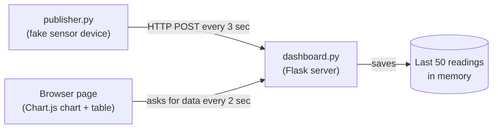

# IoT Simulator + Live Dashboard

A small project that pretends to be an IoT sensor and shows its readings live on a web page. I made it to understand how data travels from a device to a dashboard, without needing any hardware.

## What it does

- `publisher.py` acts like the sensor. Every 3 seconds it makes fake temperature, humidity and motion values and sends them to the server.
- `dashboard.py` is a Flask server. It receives the readings, keeps the last 50 in memory, and shows them on a web page with a live chart and a small table.

## Block diagram



## Files

| File | What it does |
|---|---|
| `publisher.py` | Makes fake sensor readings and sends them to the server |
| `dashboard.py` | Receives readings, stores them, serves the web page |
| `requirements.txt` | Python packages needed |

## How to run

1. Install the packages:
   ```
   pip install -r requirements.txt
   ```
2. Start the server first and keep it running:
   ```
   python dashboard.py
   ```
3. Open http://127.0.0.1:5000 in your browser. It will say "Waiting for data..."
4. Open a second terminal in the same folder and run:
   ```
   python publisher.py
   ```
5. Go back to the browser. The chart starts filling in within a few seconds.

## Built with

Python, Flask, requests, Chart.js

## What I learned

- **My first plan was MQTT, but it did not work on my network.** MQTT is what real IoT devices normally use. I tried a public broker on port 1883 and then on port 8883, on my wifi and on my phone hotspot. It timed out every time, probably because something on my laptop or network was blocking it. So I changed to a simple HTTP POST so the project would run anywhere. The rest of the idea (device, server, dashboard) stayed the same.
- **The dashboard page opening does not mean data is coming.** The web page runs on my own laptop, so it opens even when no data arrives. Data only shows after the publisher starts.
- **Why there is a lock in `dashboard.py`.** Two requests can touch the list at the same time (one adding a reading, one reading the list), so I used a lock to avoid problems.
- **Why only the last 50 readings.** A `deque` with a maximum size keeps memory usage small, however long the publisher runs.

## Limits

- Readings are only kept in memory, so everything is lost when the server restarts. The next project (`sensor-rest-api`) fixes this with a database.
- The data is random and there is only one fake device.
